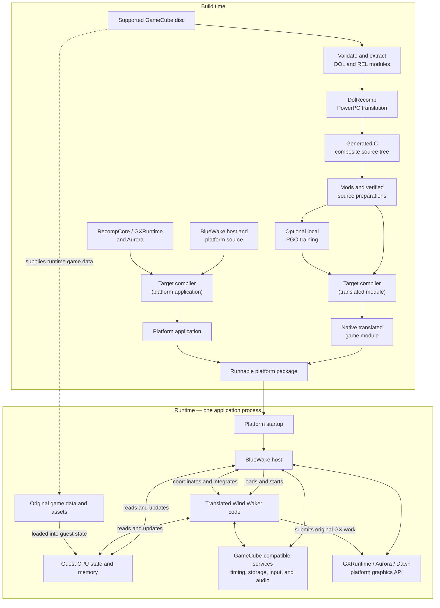

# BlueWake architecture overview

## Contents

- [Introduction](#introduction)
- [High-level view](#high-level-view)
- [Build toolchain](#build-toolchain)

## Introduction

BlueWake runs *The Legend of Zelda: The Wind Waker* on modern platforms by
**statically recompiling** the supported GameCube game's PowerPC machine code.
During the build, DolRecomp translates that code into generated C. A host
compiler then turns the generated C into native code for the target platform.
BlueWake combines that translated game code with a handwritten host and a
compatibility runtime that provide the operating-system, input, audio, storage,
timing, and graphics services the game expects.

This puts BlueWake between several related approaches:

| Approach | What it does | How BlueWake relates to it |
| --- | --- | --- |
| Conventional emulation | Interprets or dynamically translates the original CPU instructions while the game is running and models the original system around them. | BlueWake does not use a conventional CPU-emulation loop for the translated game code. The PowerPC-to-native translation happens ahead of time. Its runtime still supplies compatible GameCube hardware and operating-system behavior, including emulated or high-level implementations of individual services. |
| Decompilation | Reconstructs readable source code that represents the original program, often with recovered types, names, and higher-level structure. | BlueWake does not recover Nintendo's original source code. DolRecomp mechanically preserves the behavior of compiled instructions. Projects such as [zeldaret/tww](https://github.com/zeldaret/tww) are useful research references, but their reconstructed source is not the code BlueWake normally executes. |
| Reimplementation | Rewrites the game or its systems as new handwritten host-native code. | BlueWake has handwritten platform and runtime components, but it is not a ground-up rewrite of Wind Waker. Most original game logic comes from translated machine code. Selected services, integrations, and optimized routines may be implemented natively. |
| Static recompilation | Translates code for one CPU into code that can be compiled for another CPU before the program runs. | This is BlueWake's primary execution model. The resulting native game module retains the original program's guest memory layout and other GameCube execution semantics. |

Static recompilation describes how the game code is produced; it does not mean
that the game's state is static. During play, translated game code and the host
continuously update guest CPU state, memory, graphics state, audio state, and
other runtime data.

BlueWake requires a supported, legally obtained USA revision-0 (`GZLE01`) disc.
The repository does not contain the game, its assets, or Nintendo's original
source code.

## High-level view

Every supported target produces two principal native components: a BlueWake
platform application and a translated game module. Their file formats and
packaging differ by platform, but the application loads the module into the
same process at runtime.

The diagram shows component and data flow, not an exact call sequence. The
central boundary is consistent across platforms: translated game code remains
separate from the handwritten host and compatibility runtime.

## Build toolchain

All supported platforms share the same broad pipeline:

| Stage | Input | Result |
| --- | --- | --- |
| Validate and extract | The player's supported disc | Original DOL and 415 REL modules |
| Translate | PowerPC machine code | DolRecomp-generated C |
| Compose and prepare | Generated DOL and REL output | Verified composite source, selected mods, and guarded optimizations |
| Train, when enabled | Instrumented private build and headless playbacks | Local LLVM optimization profile |
| Compile | Prepared game source, BlueWake host, and runtime sources | Native game module and platform application |
| Package | Native outputs and required support files | Linux, Windows, macOS, iOS/iPadOS, or tvOS deliverable |

Android support is in progress in
[PR #93](https://github.com/chrissotraidis/bluewake/pull/93), so it is not yet
shown as a current platform branch.

The builders share pinned translator/runtime inputs and the verified composite
source, then branch for each platform's compiler, SDK, entry layer, graphics
backend, signing, and packaging requirements.

For the complete pipeline, component references, output paths, and per-platform
branches, continue to [Build](Build.md).
